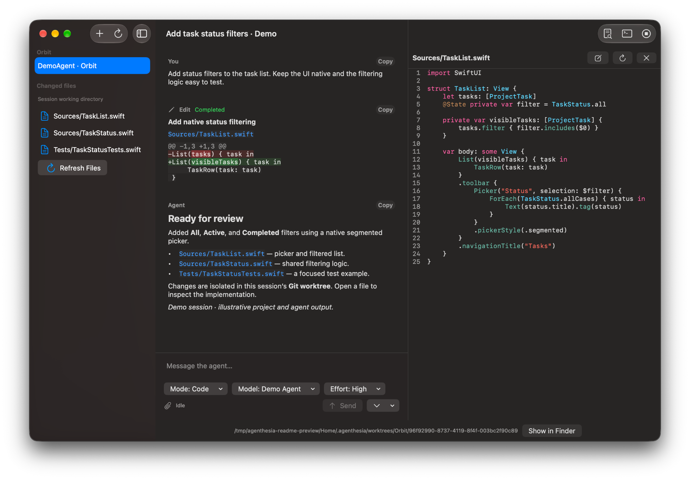

# Agenthesia

[](https://github.com/anesthetised/agenthesia/actions/workflows/ci.yml)
[](https://github.com/anesthetised/agenthesia/actions/workflows/ci.yml)

A native, opinionated macOS client for coding agents.

Agenthesia speaks the [Agent Client Protocol](https://agentclientprotocol.com) (ACP), so it works with
any ACP-compatible agent — Claude, Codex, Gemini CLI and many more. It does not ship its own agent:
it is the place where you start agents, watch them work, answer their questions, review their changes
and accept the result.

> **Status:** early development. Nothing to install yet.

<a href="docs/images/agenthesia.png">
  
</a>

*Current interface with a demo project and illustrative agent output. Click to view the original screenshot.*

## Highlights (planned for 1.0)

- **Any agent, one interface.** One-click install from the ACP Registry; agents are interchangeable.
- **Parallel sessions.** Run several agents side by side, each in its own process.
- **Isolated by default.** Every session in a git repository gets its own worktree; review the diff,
  then squash-merge or discard.
- **Built for review.** Diffs, files and Markdown with syntax highlighting; Quick Open for everything else.
- **Truly native.** SwiftUI and AppKit, keyboard-first, actionable notifications, no web views.

Cross-agent memory is deferred until after the MVP ([ADR-0012](docs/adr/0012-defer-cross-agent-memory.md)).

See [docs/VISION.md](docs/VISION.md) for the principles behind the product and
[docs/ARCHITECTURE.md](docs/ARCHITECTURE.md) for how it is built.
Rendering workloads, metrics and repeatable measurements are described in [docs/BENCHMARKS.md](docs/BENCHMARKS.md).

## Live sessions

The app opens a native session screen. Choose a project directory and an installed ACP agent command;
enter literal arguments one per line (blank lines are ignored; spaces are preserved). Project and
executable paths accept `~` for your home directory. Agents must already be authenticated. Git projects receive a fresh
`agenthesia/<uuid>` branch and worktree under `~/.agenthesia/worktrees`; only committed HEAD content is
copied. Non-Git directories are used directly. Worktrees remain on disk after closing, including failed
startup, so changes are not discarded.

Enter or Command-Return sends a text prompt while idle; Shift-Return inserts a newline and Command-period
stops the turn. You can draft the next message while the agent works; queueing and steering are still
planned. The Agent Log button shows bounded stderr output. End Session, window close, and app quit
close ACP, finish pending event writes, and terminate the agent process group.

Sessions are stored in `~/Library/Application Support/Agenthesia/history.sqlite`. The sidebar opens
saved transcripts read-only after a restart; Continue reconnects one to its agent when the agent can
resume or load sessions. A permission request appears as a card with the agent's
options; choose one with the mouse or ⌥⌘1…⌥⌘9. Nothing is allowed implicitly, and stopping or closing
answers pending requests with `cancelled`. ACP filesystem reads and writes are served inside the
session's working directory, with a path policy that refuses access outside its allowed roots.
Writes in Git sessions affect the isolated worktree. Closing the session waits for accepted file
operations to finish. Client terminal tools and attachments are not yet connected;
only implemented client capabilities are advertised.
Worktree review, merge, and discard controls remain separate work.

For a local smoke test, build with `just test`, then point the app at the package's built `MockAgent`
executable (the build directory depends on the Swift toolchain). Try `hello`, `slow`, `think`, or `fail`.
`fail` records a failed turn and pauses retained queue entries while keeping the session usable.
With an empty queue, Return sends another draft immediately; flushing the last queued entry restores
ordinary sending. Retained entries require Resume Queue or an explicit send. `exit` ends the agent without replying and exercises fatal cleanup
and Continue.
Use `write <absolute-path> <text>` to exercise permission approval and file creation, then
`read <absolute-path>` to see the content in a tool card. Use a path inside the session directory
(shown in the app), not the original checkout; an outside path must fail even after approving the tool.
The ACP command-line client remains available via `just cli` and `just mock-chat`.

## Requirements

- macOS 26 or later, Apple silicon.
- Building from source: Xcode 27, or Xcode 26.6 to match CI.

## Building

Tasks are defined in the [`justfile`](justfile) (`brew install just`):

```sh
just build   # build the core package
just test    # run package tests
just coverage  # run tests with coverage thresholds
just lint    # check formatting
just app     # build the app with xcodebuild
just run     # build and launch the app
just cli chat -- <agent>  # talk to any ACP agent from the terminal
just mock-chat            # try it with the bundled mock agent
```

CI pins Xcode 26.6. To run the same checks locally when that Xcode is installed:

```sh
DEVELOPER_DIR=/Applications/Xcode_26.6.app/Contents/Developer just ci
```

Package tests with coverage and the app build run in parallel on separate macOS runners. Each restores
its own incremental build cache, matched by OS, architecture, Xcode build and dependency/configuration
hashes. A commit-specific snapshot can be reused by later commits with the same configuration. Builds
and tests always run, including on exact cache hits; coverage profiles are cleared before each test run.
Compiler work is cached even after a test failure, while the failed check remains failed. The combined
`Lint, test, build` check requires both jobs to succeed. Only the main-branch badge publisher has write
access to repository contents.

The CLI resolves the login-shell environment once and passes it to the agent and terminal
authentication. If resolution fails or times out, it warns and uses a fallback environment. Add
`--agent-log` before `--` to stream the agent's stderr; up to the last ten retained lines are also included
when an agent exits before initialization. Process shutdown cleans up its process group, including
descendants that outlive the agent.

Coverage measures Swift sources in the package, including product UI. The badge and product total
exclude test support (`ACPTesting`, `MockAgent`) and the debug-only `AgenthesiaUI/Lab/` directory;
these are still reported separately, with the latter labeled `RenderingLab`. Per-module thresholds
remain enforced by `just coverage`. The instrumented build runs first; test execution then has a
two-minute process timeout. On timeout, macOS `sample` writes test-runner stacks to the log before
the test process group is terminated and the command fails.

## License

[GPL-3.0](LICENSE)
